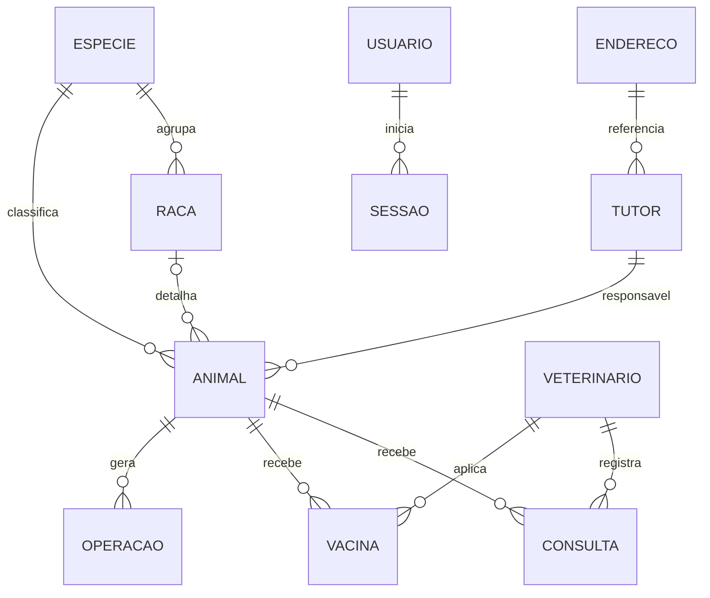
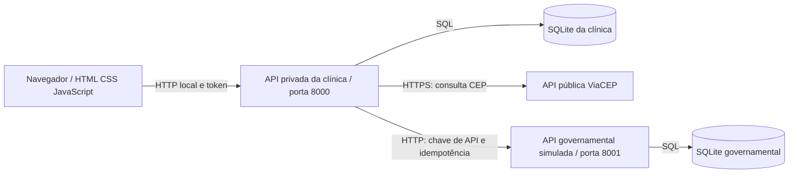

# Modelagem e arquitetura

## Modelo entidade-relacionamento (MER)

O diagrama é renderizado no GitHub. A lista abaixo dele permite ler os relacionamentos mesmo sem visualização Mermaid.

## Modelo relacional

PK é a chave primária; FK é uma referência a outra tabela. A definição executável está em [`sdm/schema.sql`](../sdm/schema.sql).

| Tabela | PK e campos principais | Relacionamentos e restrições |
|---|---|---|
| enderecos | id, cep, logradouro, numero, complemento, bairro, cidade, uf | Endereço pode servir a vários tutores. |
| tutores | id, nome, telefone | `endereco_id` FK obrigatória |
| especies | id, nome | Nome único |
| racas | id, nome | `especie_id` FK; nome único por espécie |
| veterinarios | id, nome, crmv | CRMV único |
| animais | id, nome, nascimento, microchip, versao, ativo | FKs `tutor_id`, `especie_id`, `raca_id` opcional; microchip único; FK composta garante raça da espécie correta |
| consultas | id, data, descricao | FKs `animal_id`, `veterinario_id` |
| vacinas | id, data, nome, lote, antirrabica | FKs `animal_id`, `veterinario_id` |
| usuarios | id, usuario, senha_hash, papel | Usuário único |
| sessoes | token_hash, expira | `usuario_id` FK |
| operacoes | id, chave, tipo, payload, status, tentativas, protocolo, erro, criado, atualizado | `animal_id` FK; chave de idempotência única |

O governo simulado tem um SQLite próprio com tabelas `animais`, `vacinas`, `protocolos` e `configuracao`. Os IDs de negócio cruzam a rede via JSON, e não por FK entre bancos.

## Arquitetura da solução

**Fluxo de integração:** o cadastro ou a vacina antirrábica gera uma linha em `operacoes`. Após o commit, uma tarefa da API tenta o envio. Se houver sucesso, grava protocolo e marca `ENVIADO`. Se houver erro, registra `FALHA` e preserva o conteúdo para reenvio. Operações posteriores do mesmo animal aguardam a primeira falha ser resolvida. A confirmação no governo é registrada na mesma transação da alteração remota; se a resposta se perder, repetir a chave devolve o protocolo original.
